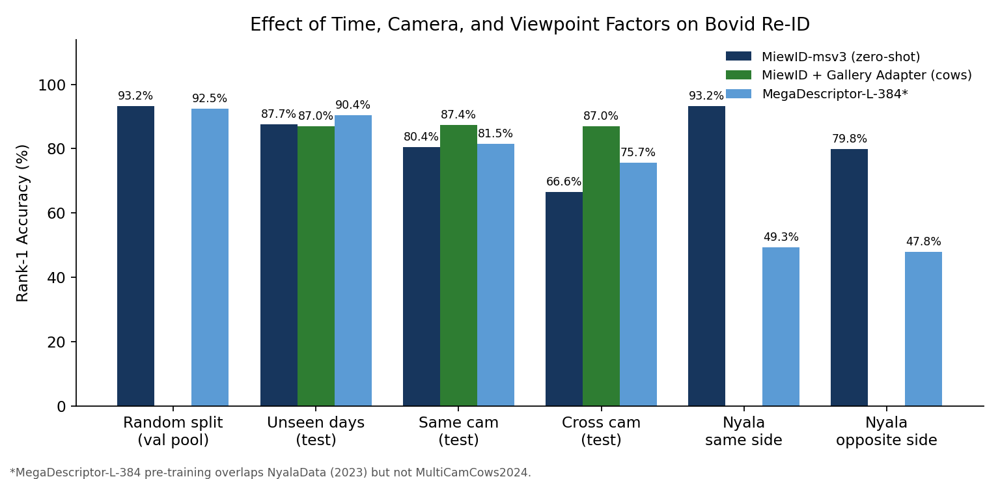
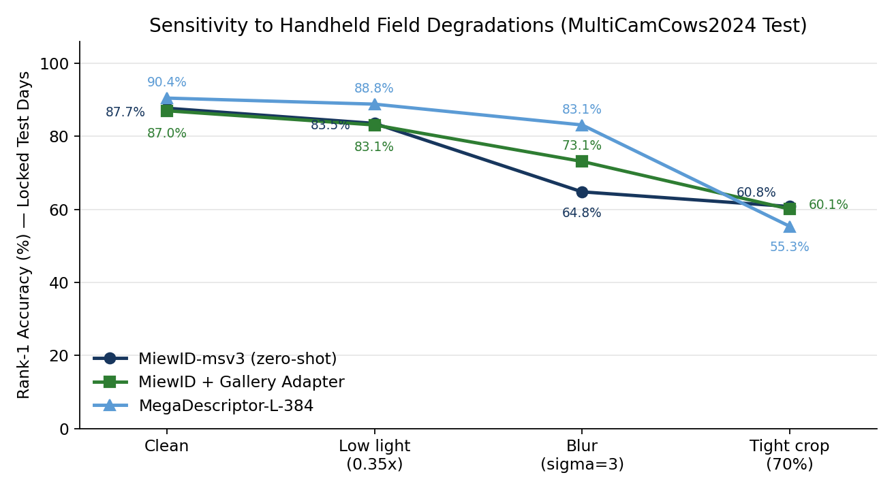
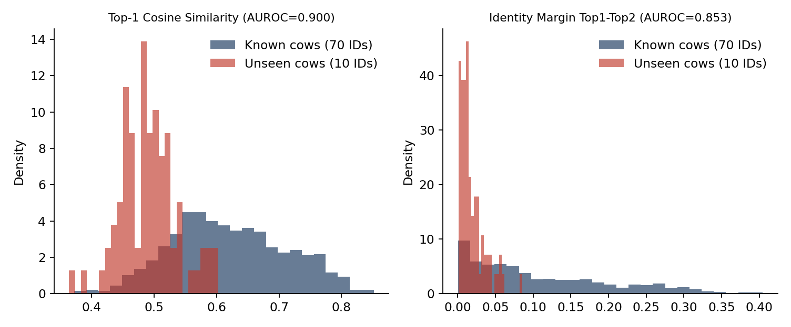
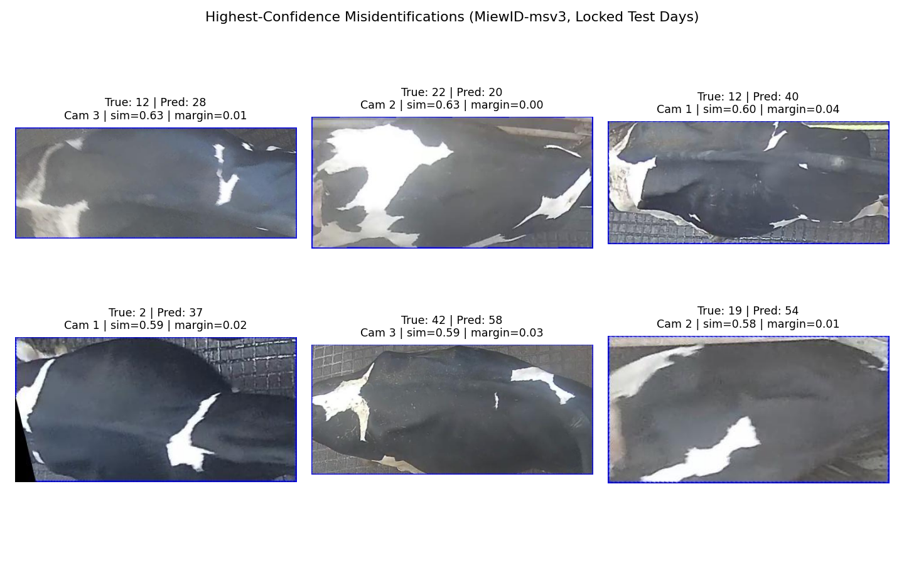

# Wildlife re-identification with MiewID: which imaging factors break matching, and can a frozen model warn us or adapt?

A small study on two public bovid datasets from WildlifeReID-10k: `MultiCamCows2024` (5,112 images of 90 dairy cows across 7 days and 3 cameras) and `NyalaData` (1,942 wild outdoor photos of 237 nyalas tagged by left and right flank). I evaluate two open re-identification backbones — `conservationxlabs/miewid-msv3` (EfficientNetV2-M + GeM pooling, 2,152-dim) and `BVRA/MegaDescriptor-L-384` (Swin-L, 1,536-dim) — and ask four questions:

- Does a naive random split hide real failure drops across unseen days, unseen cameras, and opposite animal flanks (H1)?
- Which handheld field degradation hurts most: low light, blur, or partial framing/occlusion (H2)?
- Can similarity confidence scores flag wrong matches among known animals and catch brand-new animals missing from the gallery (H3)?
- Can a small residual projection head trained on top of frozen `MiewID-msv3` embeddings (using only the first 3 gallery days) fix cross-camera failure without breaking open-set unknown detection (H4)?

Status: closed. The study plan, hypotheses H1–H4, splits, and rules were written before any model ran (`docs/plan.md`). Validation choices were locked before running the held-out test set once; the full run log is in `docs/progress.md`.

## Results

Locked test sets: `MultiCamCows2024` days 19–20 (`721` images of 70 gallery cows + `83` images of 10 never-seen cows, matched against the 1,158-image gallery from days 14–16) and `NyalaData` official test split (`444` wild images, leave-one-out retrieval).

| Evaluation condition | MiewID-msv3 (zero-shot) | MiewID + Gallery Adapter | MegaDescriptor-L-384\* |
|---|---:|---:|---:|
| Random split Rank-1 (val pool, cows) | 93.2% | — | 92.5% |
| Unseen days Rank-1 / mAP (test, cows) | 87.7% / 46.8% | 87.0% / 88.1% | 90.4% / 53.9% |
| Same-camera Rank-1 (test, cows) | 80.4% | 87.4% | 81.5% |
| Cross-camera Rank-1 / mAP (test, cows) | 66.6% / 30.1% | **87.0% / 60.5%** | 75.7% / 35.3% |
| Nyala wild same-side Rank-1 (test) | **93.2%** | — | 49.3% |
| Nyala wild opposite-side Rank-1 (test) | **79.8%** | — | 47.8% |
| Closed-set error detection AUROC (`id_margin`) | 0.911 | 0.905 | 0.919 |
| Open-set unknown AUROC (`id_margin` / `top1_sim`) | 0.853 / 0.900 | 0.894 / 0.925 | 0.850 / 0.748 |

\*`MegaDescriptor-L-384` was pre-trained on WildlifeDatasets (2023), which overlaps `NyalaData` but not `MultiCamCows2024`.



- **Camera and day shifts hurt more than random splits suggest (H1a & H1b: pass).** On validation days 17–18, `MiewID-msv3` dropped 18.2 percentage points compared with a random split (93.2% to 75.0%). On locked test days 19–20 the time drop was 5.6 pp (93.2% to 87.7%, 95% CI [85.3%, 90.2%]) — above the 3.0 pp bar in H1a, though noticeably smaller than on days 17–18, showing that single-day scores move with which days are held out. Camera shift stayed large on both splits: matching across cameras dropped `MiewID-msv3` from 80.4% to 66.6% (-13.9 pp, well above the 5.0 pp bar in H1b) and `MegaDescriptor` from 81.5% to 75.7% (-5.8 pp).
- **Opposite flank hurts wild re-ID, but less than expected — and model choice flips outdoors (H2a: direction as expected, below the 20 pp bar).** On wild `NyalaData` test photos, opposite-flank matching dropped `MiewID-msv3` by 13.3 pp (93.2% same-side to 79.8% opposite-side), below the 20.0 pp bar I set in advance — `MiewID-msv3` retained nearly 80% Rank-1 even across opposite flanks. More notably, the ranking of the two backbones flipped completely between datasets: `MegaDescriptor-L-384` led zero-shot on indoor overhead barn crops (`MultiCamCows2024`: 90.4% vs. 87.7%), whereas `MiewID-msv3` beat it by more than 40 points on wild outdoor bovids (`NyalaData`: 93.2% vs. 49.3% same-side, 79.8% vs. 47.8% opposite-side), even though `MegaDescriptor`'s pre-training included `NyalaData`.
- **Tight cropping / partial occlusion is the worst degradation (H2b: pass).** On the test set, a 70% center crop cut `MiewID-msv3` by 26.9 pp (87.7% to 60.8%) and collapsed `MegaDescriptor` by 35.1 pp (90.4% to 55.3%), well above the 5.0 pp bar. Blur (`sigma=3`) hurt `MiewID-msv3` hard (-22.9 pp to 64.8%), while `MegaDescriptor` handled blur much better (-7.4 pp to 83.1%). Low light (`0.35x` brightness) had the smallest effect (-4.2 pp on test; on validation it had actually raised `MiewID-msv3` slightly by +5.3 pp because the barn frames are bright/overexposed, mean pixel intensity 158.6/255).



- **Identity margin reliably catches wrong closed-set matches, while open-set scoring depends on the model (H3a & H3b: both pass the bar, with an open-set reversal).** Using the rule locked on validation (`id_margin = sim_top1 - sim_top2_other_id`), closed-set error detection reached 0.911 AUROC on `MiewID-msv3` (bar >= 0.75; raw `top1_sim`: 0.880) and 0.919 on `MegaDescriptor` (vs. 0.857). Abstaining on the lowest-margin 20% of test queries raised `MiewID-msv3` Rank-1 from 87.7% to 96.2% (and `MegaDescriptor` to 97.2%). For catching the 10 unseen cows missing from the gallery (`n=83`), locked `id_margin` reached 0.853 AUROC on `MiewID-msv3` (bar >= 0.80; 0.894 adapted; 0.850 on `MegaDescriptor`). However, on the test set raw `top1_sim` actually beat `id_margin` for `MiewID-msv3` open-set detection (0.900 zero-shot; 0.925 adapted, 51.8% unknown TPR at 5% FPR), reversing their validation order. In practice, using both signals — low `top1_sim` for "possibly new animal" and low `id_margin` for "ambiguous between two known animals" — makes more sense than relying on one score alone.



- **A small gallery-only adapter fixes cross-camera failure on frozen `MiewID-msv3` (H4: pass, with one clear trade-off).** Training a lightweight residual MLP (`2152 -> 512 -> 2152`, cosine classifier with margin) strictly on frozen `MiewID-msv3` gallery embeddings from days 14–16 raised cross-camera test Rank-1 from 66.6% to **87.0%** (+20.4 pp, bar >= +2.0 pp) and doubled cross-camera mAP (30.1% to 60.5%). The gap between same-camera and cross-camera matching disappeared (13.9 pp down to 0.4 pp: 87.4% vs. 87.0%). All-camera mAP jumped from 46.8% to 88.1%, blur Rank-1 rose from 64.8% to 73.1%, and open-set unknown AUROC rose rather than fell (`id_margin` 0.853 to 0.894, +0.041; `top1_sim` 0.900 to 0.925). The trade-off: all-camera Rank-1 did not improve over zero-shot (87.0% vs. 87.7%), Top-5 dropped (95.8% to 88.9%) because tighter identity clusters leave less room to recover once top-1 misses, and the adapter did not help 70% occlusion (60.1%). Also note that the adapter targets a fixed local herd (like a monitored reserve herd of known individuals plus occasional newcomers), not unseen species.
- **What the worst silent errors look like.** Sorting `MiewID-msv3` test mistakes by highest top-1 similarity shows mostly dark, low-contrast coats with small white patches cropped tightly inside the overhead camera box. Even when top-1 similarity sits around 0.58–0.63, the identity margin on all six worst failures is near zero (0.00–0.04), which is why margin flagging catches them.



What I take from it: random splits hide camera and viewpoint drops of 13–14 points, partial framing/occlusion breaks both backbones far harder than dim lighting, and `MiewID-msv3` transfers much better than `MegaDescriptor-L-384` to wild outdoor bovids. For a monitored herd photographed from varying angles, a small gallery-only residual head on top of frozen `MiewID-msv3` removes the cross-camera drop while making unseen newcomers easier to spot.

## Engineering note

`conservationxlabs/miewid-msv3`'s Hugging Face remote code (`AutoModel(..., trust_remote_code=True)`) currently fails under `transformers` v5 (`AttributeError: 'MiewIdNet' object has no attribute 'all_tied_weights_keys'`). Instead of pinning old packages, Notebooks `02` and `03` instantiate the exact `MiewIDBackbone` from `modeling_miewid.py` (`timm` `efficientnetv2_rw_m` + `GeM(p=3.0)` + `BatchNorm1d(2152)`) and load all 1,208 official `backbone.*` and `bn.*` tensors from `model.safetensors` with `strict=True`.

## Data & models

- **WildlifeReID-10k** (Kaggle `wildlifedatasets/wildlifereid-10k`): Adam, L., Čermák, V., Papafitsoros, K., & Picek, L. (2024). *WildlifeReID-10k: Wildlife re-identification dataset with 10k individual animals*. Includes `MultiCamCows2024` and `NyalaData`.
- **MiewID-msv3**: Conservation X Labs (`conservationxlabs/miewid-msv3`, Hugging Face).
- **MegaDescriptor-L-384**: Čermák et al. (`BVRA/MegaDescriptor-L-384`, Hugging Face / `timm`).

Dataset images are not stored in this repository; notebooks read them directly from the attached Kaggle dataset. `results/fig4_failure_cases.png` displays six crops from `MultiCamCows2024` for error analysis under the dataset's licence; repository code is under the MIT licence.

## Run

With the Kaggle CLI configured:

```bash
python scripts/run_on_kaggle.py 01 02   # data audit, splits, validation factors & gallery adapter
python scripts/run_on_kaggle.py 03      # locked held-out test set & figures (run once after 02)
```

Each notebook runs on Kaggle with `wildlifedatasets/wildlifereid-10k` attached and receives the previous step's outputs. Downloaded artefacts are stored under `runs/` (gitignored) and final tables/figures under `results/`.

## Layout

```text
notebooks/01_data_check.ipynb        metadata audit, corruption check, locked day/camera/ID splits
notebooks/02_val_and_factors.ipynb   MiewID-msv3 & MegaDescriptor validation, degradations, adapter
notebooks/03_test_set.ipynb          locked held-out test evaluation (days 19-20 & Nyala test) + figures
scripts/run_on_kaggle.py             pushes and polls notebooks sequentially via Kaggle CLI
results/                             summary JSONs and figures (no weights or raw dataset images)
docs/plan.md                         pre-registered hypotheses H1-H4, splits, and rules
docs/progress.md                     chronological experiment log
```
